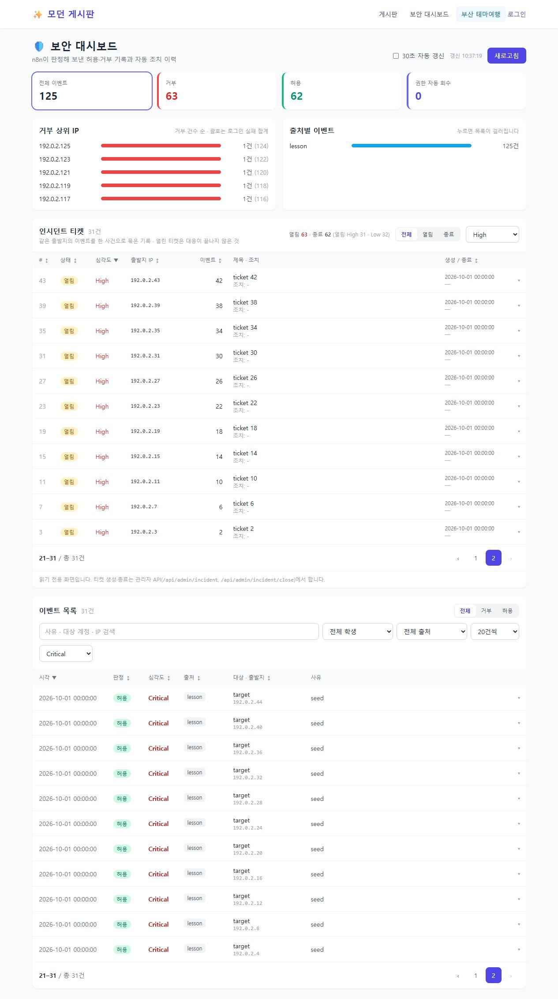

# 10-12 최신 수업: 팀 게시판 적용

대상은 이 저장소의 `flask-board/`입니다. 이 PC의 경로는
`C:\SKT aleph\flask-board-team\flask-board`이며 팀원은 자신의 Clone 경로에서 실행합니다.
개인 게시판에 먼저 검증한 변경을 팀의 실제 코드에 통합했습니다.

## 적용한 내용

강사님 원본 [Python-Lab-ALeph-T](https://github.com/lsy3709/Python-Lab-ALeph-T)의
10-11 최신 커밋 `989f1f6`까지 확인했습니다.

| 수업 변경 | 팀 게시판 적용 |
| --- | --- |
| 10-01 `392267c`: 20건 페이징·정렬·심각도 필터 | 기존 `pagination.py`를 실제 두 목록 API에 연결, 대시보드 머리글 정렬과 페이지 버튼 추가 |
| 10-11 `193e27e`: 404 Wazuh 이중 출력 | 404 요청을 `http_404`로 호스트 파일에 기록하면서 Graylog 전송 유지 |
| 10-11 `a1840e1`: S6·S9 호스트 로그 | API 인증 실패 `admin_auth_fail`, 골드 열람 `gold_access`, 과잉권한 `priv_unauthorized_admin` 기록 |
| 10-11 `989f1f6`: Manager 이름 변경 | 각 PC의 실제 이름 사용. 이 PC는 기존 `wazuh-manager` 유지 |

앱과 독립 실행 봇은 `security_log.py`로 로그 형식을 공유합니다. 밀리초·첫 프록시 IP·
개행/제어문자 치환·길이 제한을 유지하고, 비밀번호·토큰·API 키·자료 본문은 남기지 않습니다.
`SECURITY_LOG_PATH`가 빈 값이면 기록하지 않으며, 봇의 `--dry-run`은 두 센서에 전송하지 않습니다.

기존 팀 게시판의 숫자 등급 `0/1/2`, `/gold` 페이지, 관리자 JWT/쿠키 인증과
이벤트의 검색·학생·출처 필터 및 `limit/offset` 호출을 유지합니다.
새 `page/per_page/sort/order` 호출에서 심각도는 Critical > High > Medium > Low 순서이고,
같은 정렬 값의 행은 ID로 고정합니다. 필터나 정렬이 바뀌면 화면은 첫 페이지로 돌아갑니다.

기존 예제 테스트가 드러낸 인시던트 문제도 수정했습니다. 열린 티켓의 심각도를 갱신 시
낮추지 않으며, 새 티켓에는 같은 IP의 이전 티켓 종료 이후 이벤트만 모읍니다.

## 팀원 실행 및 검증

팀 저장소의 `flask-board` 폴더에서 실행합니다. 기존 가상환경이 있으면 첫 줄은 생략합니다.

```powershell
python -m venv .venv
.\.venv\Scripts\python.exe -m pip install -r requirements-test.txt
$env:DATABASE_URL = 'sqlite:///team-board.sqlite3'
$env:JWT_SECRET_KEY = [guid]::NewGuid().ToString('N') + [guid]::NewGuid().ToString('N')
$env:GELF_ENABLED = '0'
$env:SECURITY_LOG_PATH = ''
.\.venv\Scripts\python.exe -m unittest discover -s tests -v
.\.venv\Scripts\python.exe -m pytest tests -q
.\.venv\Scripts\python.exe -m flask --app app:app run --host 127.0.0.1 --port 5001
```

접속: `http://127.0.0.1:5001/dashboard`. 회원가입·로그인·게시글 기능도 함께 확인합니다.
기존 5001 서버가 있으면 실행한 터미널에서 `Ctrl+C`로 종료한 다음 다시 실행합니다.
기존 프로세스가 `--debug` 없이 실행 중이면 Python 소스를 자동으로 다시 읽지 않습니다.
위 명령은 협업 확인 모드이며 Wazuh/Graylog 전송을 끕니다.

보안 실습은 `.env`의 DB/API 키 등 기존 개인 설정을 사용하고, 위 테스트용 환경변수를
설정하지 않은 별도 터미널에서 실행합니다. `SECURITY_LOG_PATH`는 자신의
`<게시판 폴더>\logs\security.log`로 설정하고 Agent도 같은 파일을 읽게 합니다.
[개인 경로 설정 안내](WAZUH-PERSONAL-PATH-GUIDE.md)를 함께 확인하세요.

## 추가 Wazuh 규칙 설치

게시판 소스와 별도로 Manager에 추가 디코더·규칙을 설치해야 새 로그가 경보로 표시됩니다.
파일은 팀원들과 공유 가능한 설정이며 개인 인증서·Agent 키·기존 설정 백업은 포함하지 않습니다.

| 호스트 로그 | 추가 규칙 | 레벨 |
| --- | --- | --- |
| http_404 | 100230 | 5 |
| admin_auth_fail | 100231 | 7 |
| gold_access | 100232 | 3 |
| priv_unauthorized_admin | 100233 | 10 |

이 번호는 이식 과정에서 정한 번호이며 강사님의 규칙 번호를 추정한 값이 아닙니다.
404 1건은 스캔 확정이 아니고 골드 열람은 정상 감사 기록입니다.
반복·상관 탐지 전체를 대신하지 않으므로 기존 Graylog/수업 탐지 흐름과 함께 사용합니다.

먼저 운영 환경에 접근하지 않는 격리 검증을 실행할 수 있습니다.
Docker Desktop과 수업 이미지 `wazuh/wazuh-manager:4.9.0`이 필요합니다.

```powershell
.\.venv\Scripts\python.exe scripts/verify_wazuh_signals.py
```

다음 명령의 Manager 이름은 본인 PC의 `docker ps`로 확인한 값을 사용합니다.
설치 전에 같은 파일 이름과 규칙 ID가 없는지 확인하고 기존 설정을 백업합니다.
이 파일들은 기존 `local_decoder.xml`과 `local_rules.xml`에 덮어쓰지 않습니다.

```powershell
$TeamManager = 'wazuh-manager' # 본인 환경에 맞게 변경
docker cp wazuh/decoders/flask_board_signals.xml "${TeamManager}:/var/ossec/etc/decoders/flask_board_signals.xml"
docker cp wazuh/rules/flask_board_signals.xml "${TeamManager}:/var/ossec/etc/rules/flask_board_signals.xml"
docker exec $TeamManager /var/ossec/bin/wazuh-analysisd -t
# 위 설정 검증 성공을 확인한 경우에만 재시작
docker restart $TeamManager
docker exec $TeamManager /var/ossec/bin/agent_control -l
docker exec $TeamManager filebeat test output -c /etc/filebeat/filebeat.yml
```

Manager 설치 뒤 실제 요청 → 파일 → Agent → Indexer → Dashboard를 각자의 PC에서 확인합니다.
이번 로컬 이식에서는 운영 Manager 설치·재시작·메신저 전송을 수행하지 않았습니다.

## 2026-10-12 검증 기록

팀 폴더의 가상환경 Python으로 실행했습니다.

- 전체 `pytest`: **155 passed**, 4 subtests passed. 기존 예제의 짧은 JWT 테스트 키 관련 경고 8건.
- 기존 `unittest`에 새 회귀 테스트 포함: **84개**. 이 테스트들은 위 pytest 실행에도 포함됩니다.
- 별도 Wazuh 4.9.0 컨테이너에서 `analysisd -t` 성공 및 네 신호의 기대 규칙 매칭 확인.
  네트워크를 끄고 합성 로그만 입력했으며 운영 볼륨과 경보 저장소는 사용하지 않았습니다.
- 대시보드 브라우저 검증: 125건의 두 목록, 심각도 정렬, 필터·페이지 이동 확인.
  합성 데이터와 메모리 SQLite를 사용하는 임시 서버에서 확인했습니다.
  필터 결과 31건은 두 번째 페이지에 11건씩 표시되었으며 자바스크립트 오류는 없었습니다.



팀에 추가돼 있던 강사 예제 테스트는 팀의 현재 API 계약에 맞췄습니다.
골드 조회는 `/gold` 페이지, 회원 정보는 `authenticated/user` 구조, 등급은 숫자,
공공데이터는 서버에서 HTML로 렌더링하는 동작을 검증합니다. 미등록 예제 API를 새로 공개하지 않았습니다.
공공데이터 테스트도 별도 앱/DB 및 합성 응답을 사용해 외부 네트워크 호출을 분리했습니다.
GELF 스텁은 현재 전송 코드의 소켓 컨텍스트 관리자 방식도 지원합니다.

팀원 `member_*`의 소개·진행·캡처 파일은 수정하지 않았습니다.
기존 개인 게시판, 실제 DB·`.env`·운영 Wazuh 컨테이너는 변경하지 않았습니다.

## 팀 서버 재시작 및 공유

사용자의 재시작 요청에 따라 팀 폴더의 5000·5001 Flask 서버를 기존 실행 명령,
환경변수와 SQLite DB 설정을 보존하여 재시작했습니다. 두 포트에서 최신
`page/per_page/total/total_pages/sort/order` 응답을 확인했습니다.
새 신호의 운영 Wazuh 설치는 위 별도 절차가 필요합니다.

팀원은 원격 `main`의 변경을 자신의 협업 절차에 따라 가져온 뒤 테스트 의존성을
설치하고 서버를 재시작합니다. 로컬 수정이 있다면 먼저 보존하고 병합 충돌을 검토합니다.

```powershell
git pull origin main
Set-Location flask-board
.\.venv\Scripts\python.exe -m pip install -r requirements-test.txt
```
