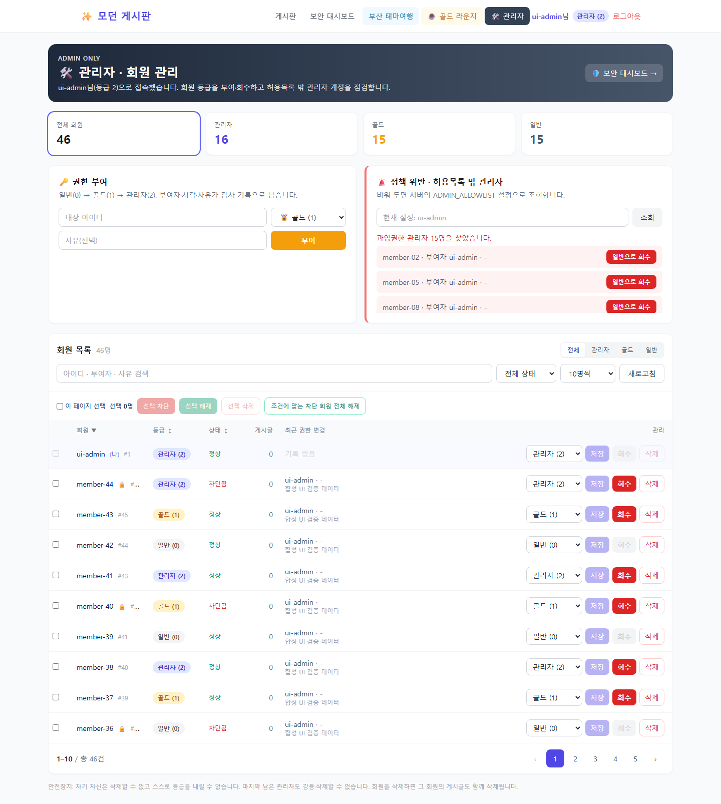
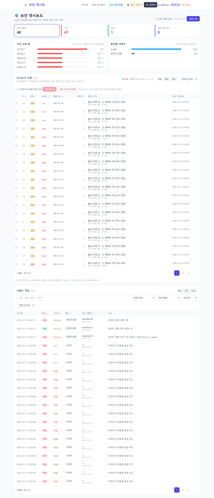

# 10-13 최신 수업: 팀 회원 일괄 관리·티켓 종료

대상은 팀 저장소의 `flask-board/`입니다. 개인 `C:\SKT aleph\flask-board`에서
검증한 기능을 팀 코드에 반영했습니다. 수업 기준은
[Python-Lab-ALeph-T 최신 main](https://github.com/myeongjundev/Python-Lab-ALeph-T/tree/main)의
`1aabb25c5479ba263c3cd9f3e09a53ff91548097`입니다.

## 반영한 내용

| 수업 변경 | 팀 반영 |
| --- | --- |
| [9e968c8](https://github.com/myeongjundev/Python-Lab-ALeph-T/commit/9e968c8): 회원 검색·페이징·차단/해제 | 서버의 검색·등급·잠금 필터·머리글 정렬, 선택 차단/해제와 조건별 전체 해제 |
| 같은 커밋: 티켓 선택·전체 종료 | 관리자 로그인 후 대시보드에서 선택 종료, 학생·심각도 조건의 열린 티켓 전부 종료 |
| [1aabb25](https://github.com/myeongjundev/Python-Lab-ALeph-T/commit/1aabb25): 회원 일괄 삭제·반응형 표 | 선택 회원과 작성 게시글 삭제, 큰 화면 콘텐츠 폭 확대, 1024px 미만 카드 목록 |

앞선 10-12의 보안 로그·Wazuh 규칙·인시던트 최고 심각도 유지·종료 이후 재취합은
팀에 이미 반영돼 있어 유지했습니다. 이번에는 종료 재요청 시 종료 시각 보존도 추가했습니다.
공통 `pagination.py`·기존 숫자 등급·권한 API·테마여행·골드 페이지·팀 기본 포트 5001을 사용합니다.

## 사용 방법

1. 저장소 루트에서 `git pull --ff-only origin main` 후 팀 `flask-board` 폴더로 이동합니다.
2. 기존 실행 터미널에서 팀 서버를 종료하고 기존 DB·환경변수로 다시 실행합니다.
   Python 코드 변경은 `--debug` 없이 실행된 서버에 자동 반영되지 않습니다.
3. 관리자 등급 계정으로 로그인한 뒤 `/admin` 또는 `/dashboard`에 접속합니다.
4. 회원 목록에서 검색·등급·상태 조건을 고르고, 체크한 회원을 차단·해제·삭제합니다.
   전체 해제는 검색·등급 조건에 맞는 **차단된 회원 전부**를 처리하며 다른 페이지도 포함합니다.
5. 대시보드에서 열린 티켓을 체크해 선택 종료하거나, 학생·심각도 조건에 맞는
   **열린 티켓 전부**를 종료합니다. 이미 종료한 티켓은 종료 시각을 바꾸지 않습니다.

기본 협업 확인 서버는 루트 README의 SQLite 설정을 사용합니다.

```powershell
Set-Location .\flask-board
# DATABASE_URL·JWT_SECRET_KEY 등은 기존 실행 환경값을 사용
.\.venv\Scripts\python.exe -m flask --app app:app run --host 127.0.0.1 --port 5001
```

첫 관리자 계정 준비는 [등급 관리 안내](ROLE-ACCESS-CONTROL.md)를 따릅니다.
기존 로컬 DB의 회원을 관리자(2)로 지정할 때는 본인 계정명과 DB 연결을 먼저 확인합니다.

```powershell
.\.venv\Scripts\python.exe scripts/manage_roles.py --list
.\.venv\Scripts\python.exe scripts/manage_roles.py --promote 본인아이디 --role 2
```

선택 작업은 최대 500개 양의 정수 ID를 받습니다. 자기 계정의 차단·삭제를 건너뛰고,
마지막 관리자도 남깁니다. `soarbot`은 단건·일괄 삭제에서 보호합니다.
쓰기 요청은 서버에서 관리자 JWT/쿠키 또는 관리자 API 키를 검사하고, 쿠키에는 CSRF가 필요합니다.
권한 회수 봇의 `/api/admin/users?role=admin`은 기존처럼 **전원 조회**합니다.
페이지·필터·정렬 변경 시 선택을 초기화하며, 조회 중인 이전 행의 선택과 늦은 응답을 제어합니다.

## API

| 호출 | 내용 |
| --- | --- |
| `GET /api/admin/users?page=1&per_page=20&q=...&role=...&locked=0/1&sort=username&order=asc` | 필터와 서버 페이징. page/per_page가 둘 다 없으면 기존 전원 조회 |
| `POST /api/admin/users/lock` `{ids:[...]}` | 선택 계정 잠금 |
| `POST /api/admin/users/unlock` `{ids:[...]}` | 선택 계정 잠금 해제·실패 카운트 초기화 |
| 같은 API `{all_locked:true,q?,role?}` | 조건에 맞는 차단 회원 전체 해제 |
| `POST /api/admin/users/delete` `{ids:[...]}` | 선택 회원·작성 게시글 삭제와 감사 이벤트 |
| `POST /api/admin/incidents/close` `{ids:[...]}` | 선택한 열린 티켓 종료 |
| 같은 API `{all_open:true,student?,severity?}` | 조건에 맞는 열린 티켓 전부 종료 |

회원 차단·해제·삭제의 실제 변경은 `admin-console` 감사 이벤트로 대시보드에 표시합니다.
회원 전원 차단·전원 삭제는 제공하지 않습니다. 선택 삭제 전 화면에서 대상과 게시글 삭제를 확인합니다.

## 검증 기록

2026-10-13 KST, 팀 폴더의 `.venv`로 실행했습니다.

```powershell
$env:GELF_ENABLED = '0'
$env:SECURITY_LOG_PATH = ''
$env:PYTHONIOENCODING = 'utf-8'
.\.venv\Scripts\python.exe -m pytest tests -q
.\.venv\Scripts\python.exe -m unittest discover -s tests -v
git diff --check
```

- 전체 pytest **172 passed, 72 subtests passed**. 기존 짧은 JWT 테스트 키 관련 경고 8건.
- unittest **101개 통과**. 신규 `test_admin_bulk.py` 17개가 위 pytest에도 포함됩니다.
- 25명 관리자 전원·페이지 접근, 검색 와일드카드 이스케이프, 인증·CSRF, 자기 계정·
  마지막 관리자·시스템 계정 보호, 외래키를 활성화한 게시글 정리, 전체 해제·티켓 종료를 확인했습니다.
- `scripts/verify_admin_ui.py`로 쿠키만으로 로그인한 관리자, 검색·정렬·쪽 이동·선택 초기화,
  회원 차단/해제·게시글 2건을 포함한 삭제, 모바일 티켓 선택 종료와 조건별 42건 전체 종료를 검증했습니다.
  1440/1024/768/390px에서 가로 넘침과 JavaScript 오류가 없었습니다.

브라우저 검증은 설치된 개인 게시판 Python 환경의 Playwright/Chromium으로 **팀 소스**를 실행했습니다.
팀 `.venv`에서 재현할 때는 개발용 Playwright와 Chromium을 설치합니다.

```powershell
.\.venv\Scripts\python.exe -m pip install playwright
.\.venv\Scripts\python.exe -m playwright install chromium
.\.venv\Scripts\python.exe scripts/verify_admin_ui.py
```

스크립트는 임시 DB·빈 로컬 포트·합성 데이터만 사용하고 종료 시 서버·DB를 정리합니다.
아래 화면도 실제 회원·티켓이 아닌 **합성 데이터 검증 화면**입니다.





[모바일 관리자 화면](../image/lesson_updates_20261013/admin-390.png) ·
[모바일 대시보드](../image/lesson_updates_20261013/dashboard-390.png)

## 적용 범위

이번 변경은 팀 저장소 코드·문서·검증 결과입니다. 기존 실행 서버를 재시작하거나
실제 회원·티켓·DB·Wazuh/Graylog/n8n 설정을 변경하지 않았습니다.
`member_01`~`member_04`의 제출 자료와 기존 미등록 캡처·PHP 파일은 수정·추가하지 않았습니다.
